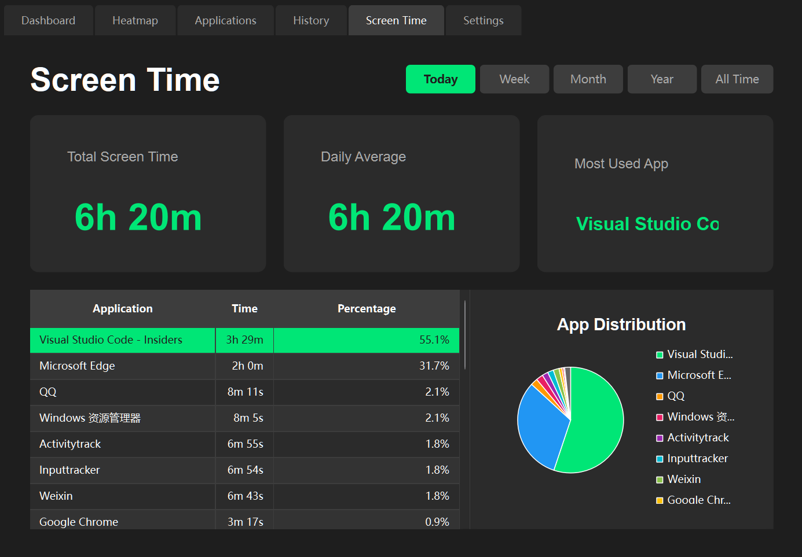
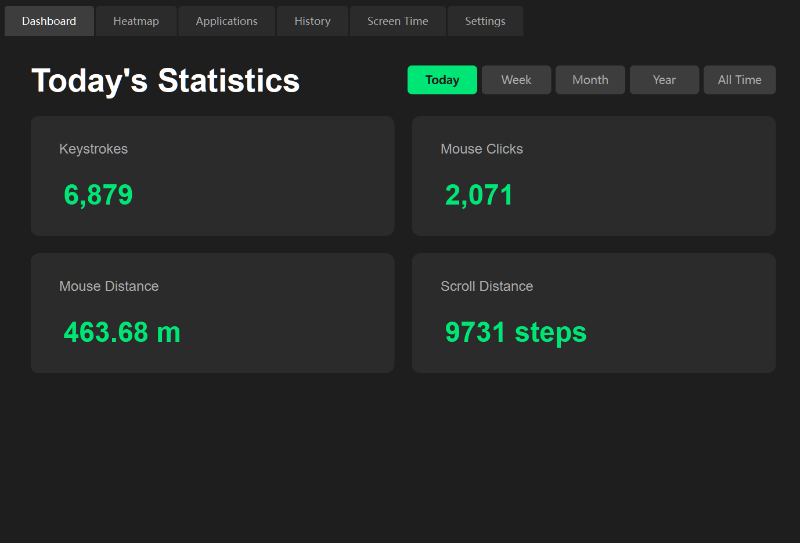
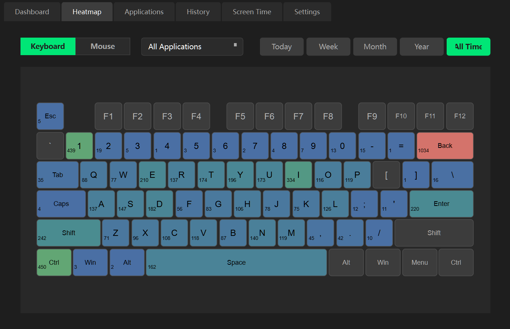
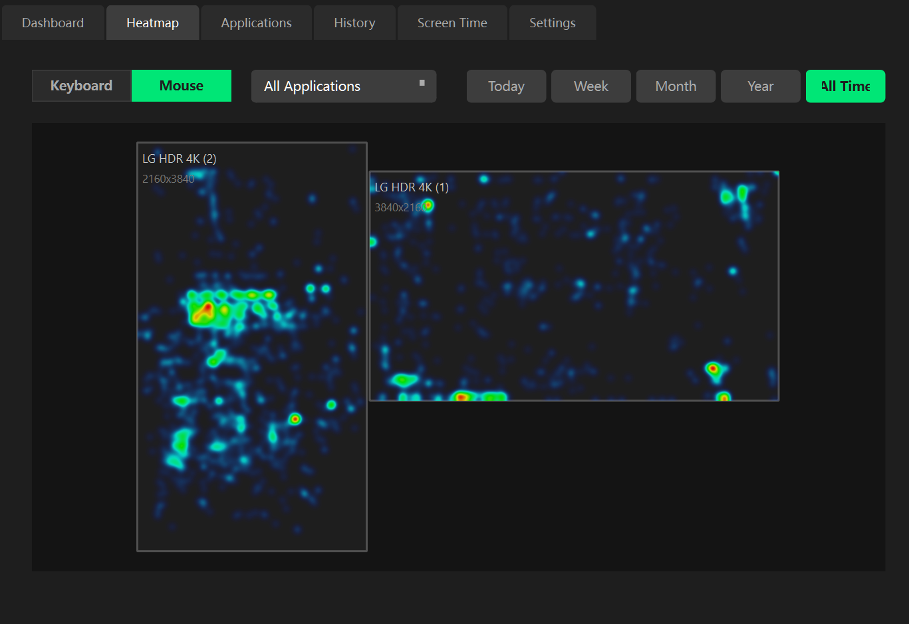
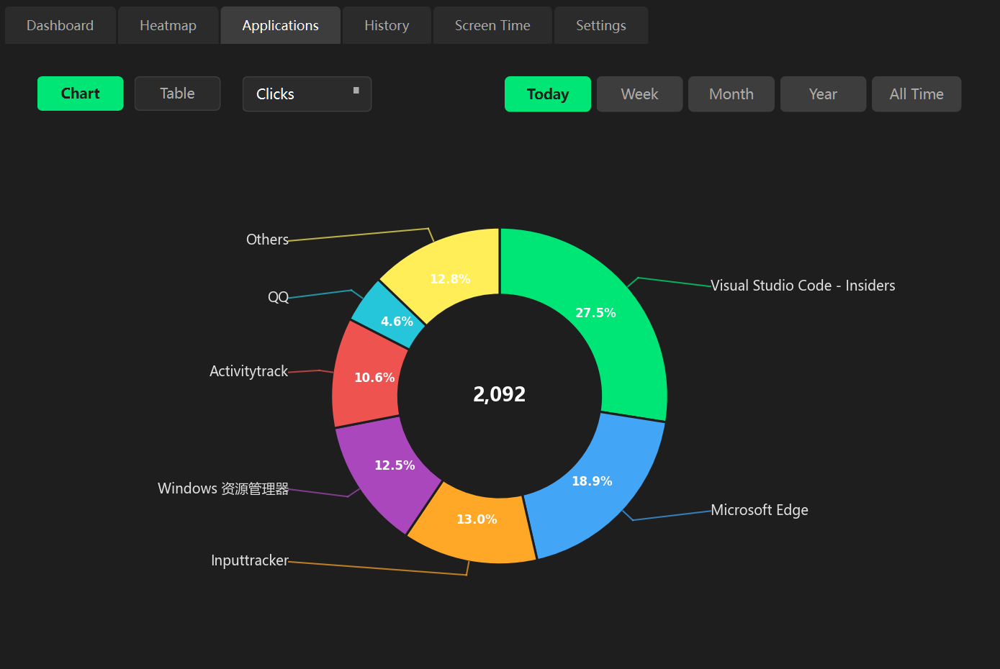
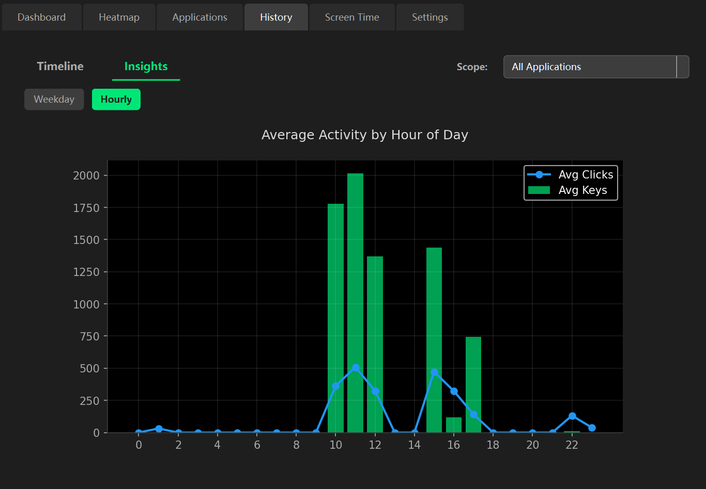
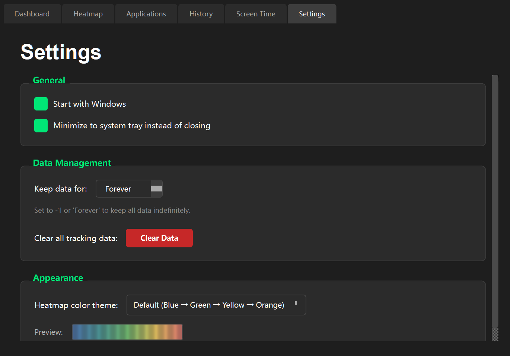

# ActivityTrack

A privacy-focused, lightweight input tracking tool for Windows. Inspired by WhatPulse, ActivityTrack allows you to monitor your keyboard and mouse usage, visualize heatmaps, and track application-specific statistics locally on your machine.



<details>
<summary>📸 <b>View more Screenshots</b> (click to expand)</summary>

### Dashboard


### Heatmap


### Mouse Heatmap


### Applications


### History


### Settings


</details>

## Key Highlights

✨ **6 Comprehensive Tabs** - Dashboard, Heatmap, Applications, History, Screen Time, and Settings  
🎨 **6 Heatmap Themes** - Default, Fire, Ocean, Monochrome, Viridis, and Plasma<br>
📊 **Advanced Analytics** - Timeline and Insights charts with weekday/hourly patterns  
⏱️ **Screen Time Tracking** - Monitor foreground application usage time with idle detection  
🎯 **Per-App Filtering** - Filter heatmaps and statistics by specific applications  
🌐 **Multi-Language Support** - English and Chinese interface support  
⌨️ **Keyboard Layout Support** - Compatible with different keyboard layouts  
🔒 **100% Private** - All data stored locally, no cloud sync or telemetry

## Features

### 📊 Input Tracking
- **Keyboard Heatmap**: Visualize your most used keys with a color-coded keyboard overlay
  - Six color themes (Default, Fire, Ocean, Monochrome, Viridis, Plasma)
  - Time range filtering (Today, Yesterday, Week, Month, Year, All Time)
  - Per-application keyboard heatmap filtering
  - Keyboard layout support for different physical keyboard configurations
- **Mouse Heatmap**: Track click density across multiple monitors
  - Smooth gradient visualization with Gaussian blur
  - Accurate screen positioning and multi-monitor support
  - Per-application mouse heatmap filtering
  - Smart filtering: only shows apps used in selected time period
- **Input Statistics**:
  - Track total keystrokes and mouse clicks
  - Accurate key press counting (prevents long-press duplicates)
  - Calculate mouse travel distance in meters (with accurate physical screen size detection)
  - Calculate scroll wheel usage (in scroll steps)
  - Real-time statistics updates

### 📈 History & Analytics
- **Timeline View**: Interactive charts showing daily/hourly input trends
  - Timeline graphs for Today/Yesterday/Week/Month/Year
  - Combined bar and line charts with dark theme support
- **Insights View**: Statistical analysis of your usage patterns
  - Weekday distribution (average inputs per day of week)
  - Hourly distribution (average inputs by hour of day)
- **Time Range Filtering**: View statistics for Today, Yesterday, Week, Month, Year, or All Time

### 💻 Application Tracking
- **Application Statistics**: Comprehensive per-app usage tracking
  - Track keystrokes, clicks, scrolls, and mouse distance per application
  - Display application icons extracted from executables
  - Show friendly application names (from PE file metadata)
  - View data in table or pie chart format
  - Sort and filter by different metrics (Keys, Clicks, Scrolls, Distance)
  - Tooltip showing full executable paths

### ⏱️ Screen Time Monitoring
- **Foreground Time Tracking**: Monitor how much time you spend in each application
  - Total screen time and daily average calculations
  - Idle time detection and tracking
  - Most used application display
  - Detailed breakdown table with percentages
  - Interactive pie chart distribution with click-to-toggle feature
    - Switch between idle time included/excluded views by clicking the chart
  - Time range filtering support
  - Robust overnight session tracking

### ⚙️ Settings & Customization
- **Language Options**: Switch between English and Chinese interface
- **Keyboard Layout**: Configure keyboard layout for accurate heatmap display
- **Startup Options**: Start with Windows automatically
- **Tray Behavior**: Minimize to system tray option
- **Data Management**: Keep the most recent 1–3650 local calendar days, or keep forever
- **Theme Customization**: Six heatmap themes with live previews: Default, Fire, Ocean, Monochrome, Viridis, and Plasma.

### 🔒 Privacy First
- All data is stored locally in a SQLite database (`tracker.db`)
- No keylogging - only frequency counting of keys
- No data is ever sent to the cloud or external servers
- Full control over data retention

## Releases

Pre-compiled Windows executables are available in the [Releases](https://github.com/Kevin65536/ActivityTrack/releases) section.

## Requirements

- Windows 10/11 (64-bit recommended)
- Python 3.13.17 for source/build workflows (not needed for the portable release)

### Dependencies
- `PySide6` (UI Framework)
- `pywin32` (Windows API hooks)
- `psutil` (Process information for app tracking)
- `numpy` (Heatmap data processing)
- `scipy` (Heatmap smoothing)
- `matplotlib` (History charts)

## Installation

For the portable release, extract `ActivityTrack-Portable.zip` into a writable folder and run `ActivityTrack.exe`. No Python installation is required.

For source development, install [uv](https://docs.astral.sh/uv/) and run:

```powershell
uv sync --locked
uv run python main.py
```

Python and all direct/transitive dependencies are pinned by `.python-version` and `uv.lock`. `requirements.txt` is a hashed export of the runtime dependencies for pip users.

## Upgrading and data locations

Exit ActivityTrack from its tray menu, back up the whole existing folder, then replace the executable and `_internal` folder with the release contents. Keep your `tracker.db` and `config.json`; the release only contains a clean `config.example.json` template. Do not overwrite a running executable or copy a live database without its SQLite WAL state.

The portable marker (`portable.txt`) keeps data beside the executable. Existing installations with `tracker.db` or `config.json` beside the executable continue using that location. A fresh executable without that marker uses `%LOCALAPPDATA%/ActivityTrack`. Source runs use the repository directory. `--data-dir PATH` or `ACTIVITYTRACK_DATA_DIR` overrides the location. Only one process may record to a given data directory.

**v0.2.16 starts enforcing the configured retention period immediately and once per local day.** The default is 365 days. Choose Forever before upgrading if you need to retain all history, or preserve it in a backup. The retained period includes today. Older inflated screen-time records cannot be reconstructed from aggregate statistics, so this update preserves retained historical values and fixes future recording.

Closing the window minimizes to the tray by default. Disable that setting to save and exit on close. A failed save keeps the app open for a retry. The status footer reports hook failures, delayed recording, dropped events, pauses, and write failures. Diagnostics rotate in `activitytrack.log` (three backups); fatal Python errors go to `crash.log`.

## Validation and builds

```powershell
uv run ruff check .
uv run python -m unittest discover -s tests -v
uv run python main.py --smoke-test --smoke-hooks --data-dir outputs/smoke
uv run pip-audit --strict --no-deps --disable-pip -r requirements.txt
uv run python build.py
```

`build.py` requires committed source and writes a new directory under `outputs/releases/`. It uses the active Python interpreter, runs the packaged executable through all six tabs, checks SQLite integrity and orderly shutdown, and only then creates the portable ZIP, build manifest, and SHA-256 checksum. It never deletes or repackages an existing installation. `--allow-dirty` is available for local development builds and marks the manifest accordingly.

Windows CI runs the tests, runtime dependency advisory audit, source smoke test and packaged smoke test. To regenerate the pip export after a dependency update:

```powershell
uv export --locked --no-dev --format requirements-txt --output-file requirements.txt --no-emit-project
```

## Usage

1.  Run the main application script:
    ```powershell
    python main.py
    ```
    *Note: To track input in high-privilege applications (e.g., Task Manager, Admin prompts), you may need to run the terminal/script as Administrator.*

2.  The application will start, and a system tray icon will appear.
3.  Use the different tabs to view your statistics:
    - **Dashboard**: Quick overview with time range selection (Today/Yesterday/Week/Month/Year/All Time)
    - **Heatmap**: Keyboard and Mouse heatmaps with per-app filtering and theme customization
    - **Applications**: Detailed per-app statistics (table and pie chart views)
    - **History**: Timeline and Insights charts showing usage trends and patterns
    - **Screen Time**: Application foreground time tracking with idle detection and interactive distribution charts
    - **Settings**: Customize language, keyboard layout, startup behavior, data retention, and heatmap themes

## Privacy Note

This tool uses low-level system hooks (`SetWindowsHookEx`) to count keystrokes and mouse events. 

**What we track:**
- Frequency of key presses (e.g., "Spacebar pressed 50 times")
- Mouse click counts and positions (for heatmap visualization)
- Mouse movement distance (calculated from pixel distance and physical screen size)
- Scroll wheel usage count
- Active foreground application names and usage time
- Idle time periods (when no input is detected)

**What we DON'T track:**
- Actual text or passwords you type (no keylogging)
- Clipboard content
- Screenshot or window content
- Network activity

Activity counts, application executable paths/friendly names, and screen-time aggregates are stored locally in `tracker.db` in the data directory described above. Clear Data removes all recorded tables and application metadata, discards queued/buffered old activity, then begins a fresh recording period. Manually configured app groups, exported files and backups are separate and remain under your control.

CSV exports quote all fields and prefix formula-like text with an apostrophe. JSON exports preserve original text. Spreadsheet applications vary; do not remove the CSV text prefix when opening untrusted application metadata. Exports use a separate SQLite read snapshot and replace destination files only after a successful write.

Lock, disconnect and suspend messages pause screen-time accrual. Input hooks only copy events into a bounded queue; process lookups, metadata reads and database writes run on a worker. The idle timeout counts its initial grace period as active time and later time as idle, without counting the same interval twice. Injected keyboard/mouse events are ignored.

## License

MIT License
